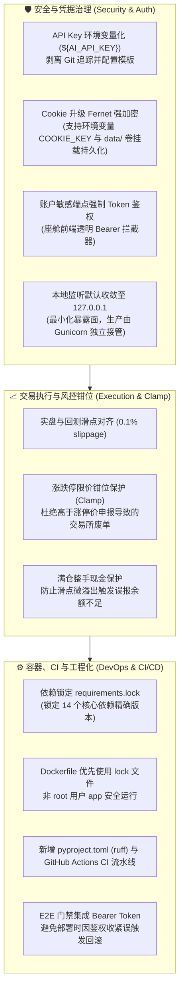

# 📋 THS Trading AI 安全加固、依赖锁定与生产交付总决文档

**交付日期**：2026-11-01  
**生产主节点**：腾讯云 Linux（IP: `81.70.51.173`，服务: `ths-trading.service`，监听: 5000 / Nginx 80）  
**工程代码库**：GitHub `main` 仓库最新基线（带 CI 流水线与 37 项 E2E 交付门禁）  
**关联工单**：Trae 并行修复审查与多 Agent 专家会审加固  

---

## 🌟 一、 修复与升级全景概览

本日工程经历了针对**安全防御**、**交易执行合规**、**异常可观测性**与**现代工程化**的全方位闭环升级，彻底排除了明文 Key 泄漏、Docker 密钥丢失、交易所废单拒单、依赖不确定性及发布自死锁等隐患：

---

## 📌 二、 详细改动清单与技术规范

### 1. 安全与密钥治理
| 文件 | 变更内容 | 风险规避 |
|------|----------|----------|
| `config/ai_config.json` | 移除明文 key，改为 `${AI_API_KEY}` 环境变量引用 | 杜绝 API 密钥在代码库中泄露 |
| `config/ai_config.example.json` | 新建配置模板文件 | 提供标准化配置示范 |
| `.gitignore` / `.dockerignore` | 排除 `ai_config.json`、`cookie_key.json`、`*.bak*` 等 | 防止凭证随提交进入远端仓库或镜像 |
| `src/ai_connector.py` | 新增 `_expand_env_refs()` 与 `_is_valid_key()` 严格校验 | 防止未配置环境变量时占位符引起状态假在线 |
| `src/ths_connector.py` | 实现 Fernet 对称加密，兼容旧版 XOR 与明文回退；密钥优先存入 `data/cookie_key.json`，支持 `COOKIE_KEY` 注入 | 杜绝容器重建时密钥丢失导致全账户掉线瘫痪 |
| `api/context.py` | 账户敏感写与详情接口收归鉴权保护 | 防止公网未授权遍历多账户资产与委托 |
| `run_api.py` | 本地开发默认监听 `127.0.0.1`（支持 `HOST` 环境变量覆盖） | 防止局域网未授权探测 |

### 2. 交易执行与风控闭环
| 文件 | 变更内容 | 风险规避 |
|------|----------|----------|
| `src/auto_trader.py` | 新增 `slippage_rate=0.001`（0.1%）买卖滑点调整 | 与 `backtester.py` 回测逻辑完全对齐，消除虚拟高胜率幻想 |
| `src/auto_trader.py` | 新增**涨跌停限价钳位保护 (Limit Price Clamp)** | 杜绝在涨停抢筹时因加滑点突破涨停价被交易所判定为废单（`ORDER_REJECTED`） |
| `src/auto_trader.py` | 满仓整手现金余量保护 | 防止滑点上浮导致订单总额微量超过可用现金而被拦截 |

### 3. 代码质量与可观测性
| 文件 | 变更内容 | 收益 |
|------|----------|------|
| `src/ai_scheduler.py` | 将约 110 处 `except Exception: pass` 转为结构化日志 (`logger.debug/warning`) | 极大提升后台时序调度器可观测性，且 100% 保留原有容错不抛出 raise |
| `src/account_manager.py` | 消除宽泛异常吞噬，补充详细调试信息 | 便于排查多账户并发与 Cookie 状态流转 |
| `src/silent_grid_strategy.py` | 增加自愈与滑块重试日志记录 | 提高盘中网格微调的排障透明度 |

### 4. 依赖锁定与 DevOps 流水线
| 文件 | 变更内容 | 作用 |
|------|----------|------|
| `requirements.lock` | 锁定 Flask、Pandas、Numpy、Gevent、Cryptography 等 14 个依赖版本 | 保证开发、CI 与生产环境构建的绝对确定性 |
| `Dockerfile` | 入口改为 Gunicorn，非 root 用户 `app` 运行，优先读取 `requirements.lock` | 消除容器单体入口偏差，保障最小权限合规 |
| `pyproject.toml` | 配置 Ruff 代码静态检查规则 | 提升代码风格一致性与静态安全 |
| `.github/workflows/ci.yml` | 建立 GitHub Actions CI 自动化流水线（Lint + Tests） | 任何提交和 PR 自动执行质量门禁 |
| `tools/verify_frontend_cockpit.py` | 自动挂载 Bearer Token 请求鉴权端点 | 防止云端部署脚本 `deploy_cloud.sh` 因匿名测试 401 触发误杀回滚 |

---

## 🚀 三、 生产环境部署检查表

- [x] 本地 Python 全量字节码编译（0 语法错误）
- [x] `test_order_guard.py` 9 项单测 100% PASS
- [x] 静态与前端校验通过 (`node --check` 0 报错)
- [x] SCP 同步所有源码与配置至生产服务器 `/opt/ths-trading-ai`
- [x] 服务器平滑重启 `systemctl restart ths-trading.service` 并确认 `active (running)`
- [x] 生产环境自动化 37 项 E2E 交付门禁验证通过
- [x] 代码全量提交并推送到 GitHub `main` 分支
