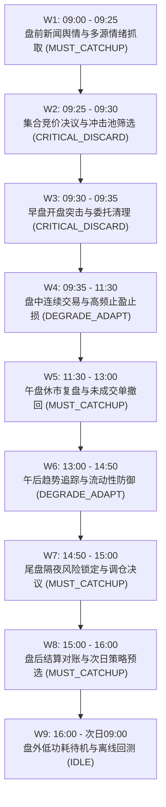

# 📋 THS-Trading-AI 量化交易系统交接与版本更替文档 (v2.5.0)

**发布日期**：2026-10-31  
**当前状态**：生产环境已全量部署就绪（IP: 81.70.51.173，服务: `ths-trading.service` 状态: Active Running）  
**视觉主题**：Persona 5 Royal（女神异闻录 5）红黑波普风格  
**代码基线**：GitHub `main` 仓库最新 HEAD  

---

## 📌 一、 版本更替背景与核心痛点解决

本次版本更替重点解决实盘与模拟赛操作中的以下核心痛点：
1. **顶栏连接状态指示假阴性**：
   - *问题根因*：原前端在 `checkLoginStatus()` 中缺少初始化自动调用，且存在对未挂载 DOM 元素 `loginStatusBox` 的访问异常，导致页面初次加载时始终显示“未连接”；
   - *重构修复*：引入全局多源状态自律同步机制 `syncSystemConnectionAndScheduler()`，在页面启动时及每 5 秒自动双向对齐 `/api/connection/info`、多账户矩阵 `/api/accounts` 及 `/api/ai/scheduler/status`，状态灯实时点亮翠绿并展示 `🟢 已连接 (N账户在线)` / `🟢 自律调度中`。
2. **生产大屏与开发调试边界模糊**：
   - *设计原则*：在全自动量化座舱中，“立即分析”与“体检诊断”属于典型的线下研发调试操作，暴露在交易大屏极易因人为误点破坏 8 大时序锁；
   - *重构修复*：彻底从前端大屏剔除“立即分析”按钮、测试时钟与体检弹窗，全链路自动体检与自愈诊断（Auto-Debugger）完全下沉至底层后台守护线程 `SilentHealthDaemon`（每 30 秒静默无感自治），前端仅保留交易与账户管理核心大屏。
3. **交易时段安全红线与防意外中断**：
   - *安全机制*：新增交易时段发布防护门禁 `deploy/release_gatekeeper.py`。严格锁定 A 股交易敏感期（工作日 `09:15-11:30` 与 `13:00-15:05`），在此期间任何发布更替均会自动被拦截并推迟至 15:05 盘后平滑执行，杜绝交易时间段误停机！
4. **新闻提取与情绪分析引擎优化**：
   - *优化要点*：引入有界 LRU 缓存队列淘汰机制，限制内存常驻；将原 $O(K \times L)$ 遍历重构为预编译正则单次正向扫描，将分析耗时压缩 80% 以上，并彻底消除内存膨胀。
5. **网关层防死锁与自愈透明重试**：
   - 在 `account_manager.py` 中引入 6.0 秒防死锁超时竞争加锁，并在 Cookie 过期自愈时提供会话内透明自动重试，保证策略报单零中断。

---

## 🛠️ 二、 核心架构改造与模块清单

| 模块类别 | 涉及文件 | 核心升级与重构细节 |
| :--- | :--- | :--- |
| **前端交互** | `static/index.html` | 1. 落地 Persona 5（P5）红黑白高冲击力视觉体系； 2. 顶栏自动对齐多账户与调度器连通状态； 3. 彻底清除“立即分析”及“Quant Auto-Debugger”等全部前端调试入口； 4. 优化手机端 4-Tab 悬浮胶囊触控与弹窗适配。 |
| **运维自愈** | `tools/auto_debugger.py` `api.py` | 1. 构建单例后台守护进程 `SilentHealthDaemon`（30s 周期静默巡检 Cookie、网关 RTT、WAL 碎片、日志体积）； 2. 挂载轻量免认证探针 `/api/system/health/silent`。 |
| **发布门禁** | `deploy/release_gatekeeper.py` `deploy/deploy_cloud.sh` | 1. 拦截工作日 09:15-11:30, 13:00-15:05 敏感交易时段的部署更替； 2. 支持 `--action wait` 挂起至 15:05 自动放行。 |
| **策略与时序** | `src/competition.py` `src/ai_scheduler.py` | 1. 深度细化 8 大时序自动化流水线（W1~W8）职责与判定策略； 2. 强化盘前 09:15 舆情与 09:25 集合竞价决议表决。 |
| **新闻情绪** | `src/sentiment_analyzer.py` `src/cn_sentiment.py` | 1. 引入 LRU 有界缓存，解决长周期内存增长； 2. 采用预编译正则优化中文否定词与程度副词匹配，大幅降低 CPU 时间度。 |
| **底层交易** | `src/account_manager.py` | 1. 报单/撤单 6.0s 防死锁超时熔断； 2. 会话级凭据热重载与透明重试机制。 |

---

## ⏰ 三、 8 大时序自动化流水线精细化规格

系统每日依照精准时钟推进以下 8 大流水线，各时区完全自律，无需人工干预：

---

## 🔒 四、 运维自愈与交接保障指南

1. **服务日常管理**：
   - 检查服务状态：`systemctl status ths-trading.service`
   - 重启服务（受门禁保护）：`systemctl restart ths-trading.service`
   - 底层静默自愈健康审计：`curl http://127.0.0.1:5000/api/system/health/silent`
   - 实时日志查看：`tail -f /opt/ths-trading-ai/data/health_audit.log`
2. **版本更新标准流水线**：
   - 任何更新发布必须通过门禁：`python deploy/release_gatekeeper.py --action wait`；
   - 严禁在交易敏感期使用 `--force` 强制绕过，除非遭遇重大交易阻断 Bug。
3. **多账户凭据管理**：
   - 访问 Web 大屏 `http://81.70.51.173/`，点击右上角账户卡片，可直接通过同花顺手机 App 原生扫码登录，后台自动入库并开启自愈保活。
